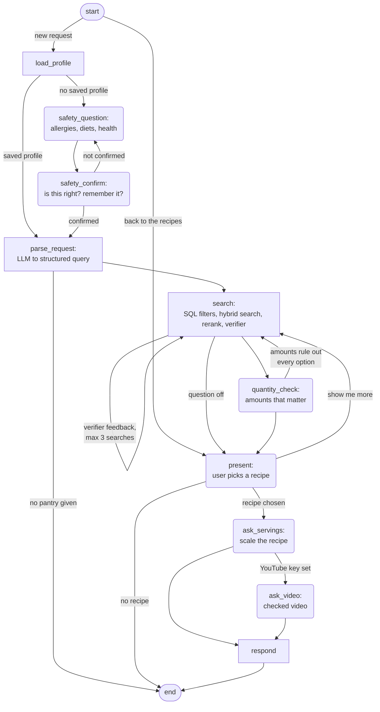

# PantryChef

[](https://github.com/mo-goodarzi/PantryChef/actions/workflows/ci.yml)

A multi-agent recipe assistant for home cooks: tell it what you have at home ("eggs, milk,
toast") and it returns recipes you can actually make, checked against your allergies and
diet, plus an optional matching YouTube video.


### [▶ Try the live demo](https://huggingface.co/spaces/mogoodarzi/pantry-chef)

## How it works

A LangGraph state machine ([graph/builder.py](src/pantry_chef/graph/builder.py)). Rounded
nodes pause and ask the user (human in the loop); the verifier runs inside `search`.



- **Code for exact checks, models for fuzzy ones.** Allergen and diet filters, ingredient
  coverage, amounts and servings are plain Python/SQL; LLMs parse the request, match
  ingredient names ("pasta" finds "spaghetti"), rerank and judge fit to the wish.
- **Allergens are enforced twice in code:** by SQL filters before ranking and by a
  deterministic verifier afterwards; for users with allergies an LLM review of the whole
  recipe, steps included, sits on top.
- **Structured outputs everywhere.** Every agent input and output is a Pydantic model;
  verifier failures are machine-readable (`missing_ingredient: flour`) and go back to the
  search as feedback.
- **Human in the loop only when it matters.** Allergies are asked once, with consent to
  store them; amounts are asked only for key ingredients where the amount changes the
  answer.
- **Swappable parts.** LLM provider, ingredient matcher, embeddings and recipe store sit
  behind small interfaces.

## Results

| What was measured | n | Baseline | PantryChef |
|---|---|---|---|
| Good answers (safe, makeable, fit ≥ 4/5), everyday requests | 100 | 70% (search only) | **96%** (full app) |
| Unsafe recipes shown, safety traps | 50 | 26, in 8 cases (safety layers off) | **0** (layers on) |
| Search hit@5 / MRR | 50 | 74% / 0.60 (ingredient coverage) | **96% / 0.86** (full search) |
| Task success when the user has too little of something | 24 | 75% (never ask amounts) | **100%** (ask when it matters) |
| Cost and p50 latency per conversation (gpt-5.4-mini) | 100 | — | **$0.010, 6.8 s** |

Judged by Claude Sonnet 5.5, a different model family from the system; the judge agrees with
blind human labels at kappa 0.54 (95% CI 0.34-0.73), so treat fit numbers as approximate.
The search row was judged by gpt-5.4-mini (kappa 0.51). Full results and limits: [docs/RESULTS.md](docs/RESULTS.md).

## What didn't work

- Diversity reranking (MMR) changed nothing measurable in search quality.
- The bigger model was not better: gpt-5.4 got 88% good answers against gpt-5.4-mini's 90%,
  at about three times the cost.
- Switching the judge to another model family did not raise agreement with human labels
  (kappa 0.55 vs 0.51, inside each other's confidence intervals).
- The cuisine rule removed every wrong-cuisine recipe from the top 5, but fit barely moved.
- gpt-5.4-nano missed "dairy free please" as a milk allergy, which rules it out for the
  safety intake.

## How this was built

I designed the architecture, the safety rules (allergens enforced twice in code) and the
evaluation plan; each decision and why is in [docs/decisions.md](docs/decisions.md). I used
Claude Code as a coding assistant under the rules in [CLAUDE.md](CLAUDE.md), one phase at a time
from [docs/IMPLEMENTATION_PLAN.md](docs/IMPLEMENTATION_PLAN.md). Every change after the first
commit went through a pull request with tests, ruff, mypy and CI; a pre-commit hook blocks local
paths and private keys. I labeled the human eval data myself, blind: 150 judge-calibration pairs
and the videos for 40 recipes. The AI did not decide which numbers to report, when a result was
good enough or what to cut (I dropped gpt-5.4-nano after its allergy miss).

## Tech stack

Python 3.12, LangGraph, Pydantic v2, OpenAI and Anthropic models, SQLite + Chroma,
sentence-transformers, FastAPI, Streamlit, YouTube Data API, Langfuse, pytest, Docker.

## Run it locally

```bash
uv sync && cp .env.example .env               # add OPENAI_API_KEY
uv run python scripts/build_db.py             # plus the data steps in docs/SETUP.md
docker compose up --build                     # UI on :8501, API on :8000
```

Data download, every build step, the terminal chat and the Hugging Face deploy:
[docs/SETUP.md](docs/SETUP.md).

## More

- [docs/RESULTS.md](docs/RESULTS.md): every evaluation, with report IDs and known limits
- [docs/decisions.md](docs/decisions.md): every design decision and why
- [docs/IMPLEMENTATION_PLAN.md](docs/IMPLEMENTATION_PLAN.md): the design and build order

Not medical advice: PantryChef turns health conditions into diet restrictions you
confirm; it never claims a recipe is medically safe.
